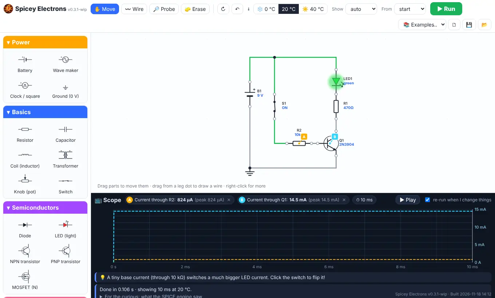
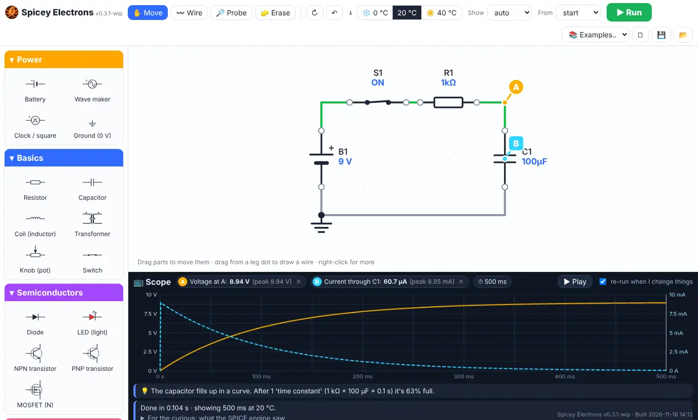
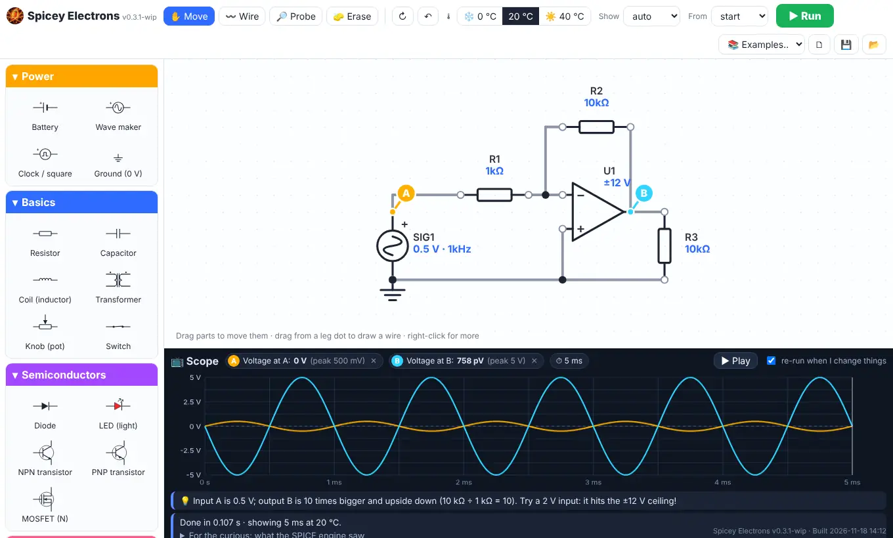
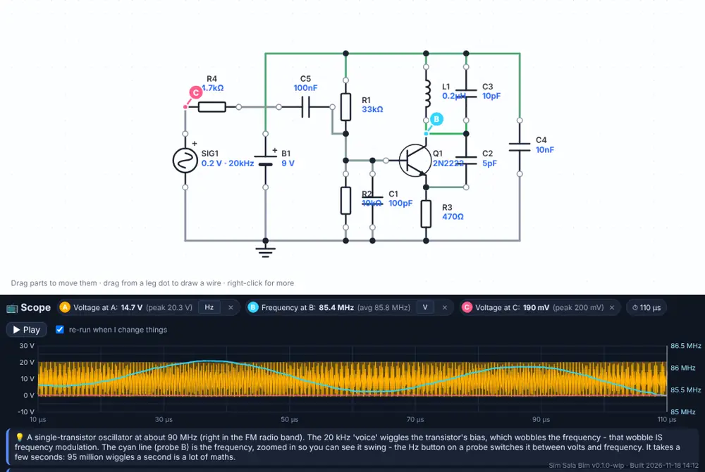
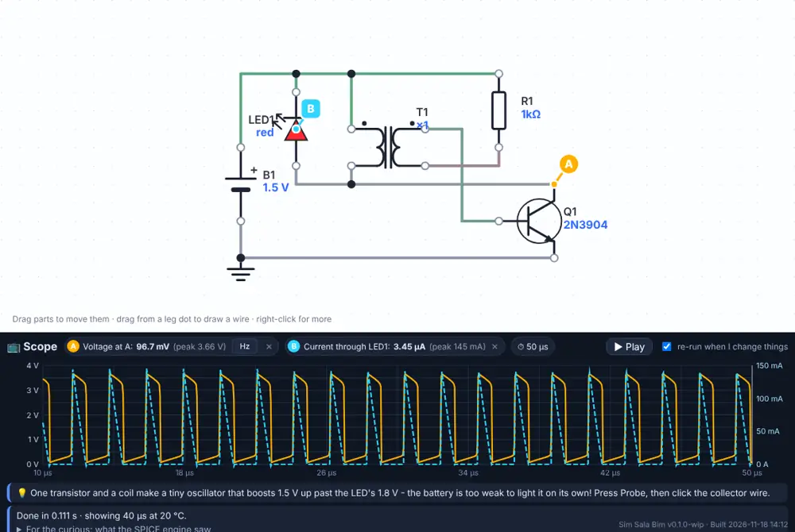
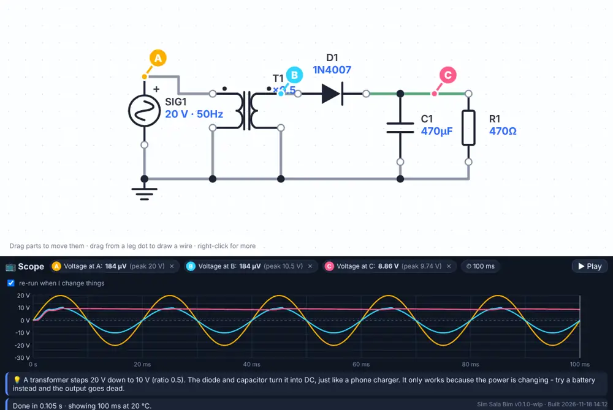
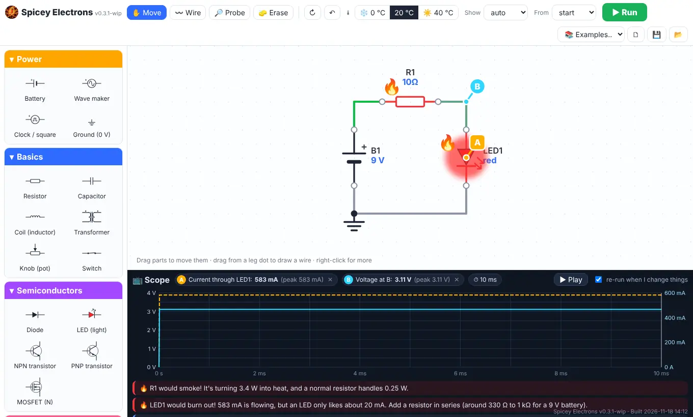

> **WORK IN PROGRESS: MANY FEATURES MAY BE BROKEN** · version 0.4.0-wip

# Spicey Electrons

*(Formerly called Sim Sala Bim.)*

**New:** capacitors and MOSFETs show a 5-segment charge bar ("C1 charge", "M1 gate") that fills as you scrub or press Play.

**A circuit simulator a 14-year-old can figure out, with a real SPICE engine underneath.**

Drag parts onto the board, wire their legs together, press ▶ Run, then clip scope probes onto
wires (voltage) or parts (current) and watch the waveforms. Wires glow green for + and red for −,
LEDs light up, and if you'd burn something out it tells you, in plain English, before your
fingers find out.

📘 **[The whole manual and research notes as one PDF](docs/SpiceyElectrons-manual.pdf)**

**Licence:** source-available under the [PolyForm Noncommercial License 1.0.0](LICENSE.md). Free
for personal, educational and other non-commercial use; commercial use needs permission. It comes
with **no warranty and no liability**: it's a learning tool, not a design sign-off, and the
mains-voltage examples are deliberately low-voltage.

Project started 2026-11-18 14:12.

---

## Why another simulator?

| | SPICE (LTspice, ngspice) | Falstad CircuitJS | Tinkercad Circuits | **Spicey Electrons** |
|---|---|---|---|---|
| Real SPICE models and maths | ✅ | ❌ own simplified engine | ❓ closed | ✅ ngspice |
| Easy for beginners | ❌ netlists, `.tran`, cryptic errors | ✅ | ✅ | ✅ |
| Runs offline on your own PC | ✅ | ✅ | ❌ online account | ✅ |
| Plain-English errors and "it'll burn" warnings | ❌ | partly | partly | ✅ |
| Temperature (0 / 20 / 40 °C) | ✅ (if you know how) | ❌ | ❌ | ✅ one click |

The research behind this (how accurate Falstad really is, licences, why not fork it) is in
[DESIGN_NOTES.md](DESIGN_NOTES.md).

## Install and run

**Just double-click the launcher for your computer:**

| Computer | Double-click | What it does the first time |
|---|---|---|
| Linux Mint / Ubuntu | `SpiceyElectrons-Linux.sh` (choose **Run**) | Offers to install `ngspice` with `apt` (asks for your password once) |
| Bazzite / Fedora Atomic | `SpiceyElectrons-Linux.sh` | Offers `brew install ngspice` (no password, no reboot) |
| Mac | `SpiceyElectrons-Mac.command` (first time: right-click › **Open**) | Offers `brew install ngspice` if you have Homebrew |
| Windows | `SpiceyElectrons-Windows.bat` | Opens the ngspice download page: unpack it into `tools\Spice64` (no admin rights needed) |

The launcher starts a tiny local server and opens the editor in your web browser. Close the black
window to quit. Nothing is sent over the internet: the server only listens on `127.0.0.1`.

You need **Python 3.8 or newer** (no extra Python packages) and **ngspice** (the engine).

### Installing ngspice by hand

- **Linux Mint / Ubuntu / Debian:** `sudo apt install ngspice`
- **Bazzite:** `brew install ngspice`
- **Fedora:** `sudo dnf install ngspice`
- **Mac:** `brew install ngspice`
- **Windows:** download the 64-bit Windows build from <https://ngspice.sourceforge.io/download.html>
  and unpack it so that `tools\Spice64\bin\ngspice_con.exe` exists inside this folder
  (or `C:\Spice64\bin\ngspice_con.exe`).

## How to use it

### 1. Add parts
Parts are grouped on the left (Power, Basics, Semiconductors, Chips). Point at one to see what it
does. **Click it, then click the board** to drop it (or drag it straight on). Press **R** while
placing to turn it.

### 2. Wire them up
**Drag from a leg dot to another leg dot.** The wire bends into an L. You can also pick 〰️ Wire and
click corner by corner (Esc to stop). A wire that ends on the middle of another wire joins it (a
dot appears); wires that just cross don't connect, just like a real circuit diagram.

### 3. Press ▶ Run
No ground symbol? It uses the battery's minus side as 0 V and tells you so. Legs that aren't
connected show up as red dots, with a message saying which one.

### 4. Probe it
Pick 🔎 Probe and:
- **click a wire** to see its **voltage** (round clip, solid line on the scope)
- **click a part** to see the **current through it** (square clip, dashed line on the scope)

Up to six probes, each in its own colour. You can add probes after a run without running again:
every voltage and current is already worked out. Click a probe's letter to remove it.

### 5. Explore
- **Drag on the scope** to move the time cursor. The wires recolour and the LEDs brighten to match
  that moment. **▶ Play** runs it in slow motion.
- **Hover** any wire or part for its voltage or current at the cursor time.
- **Change a value:** double-click a part (or click its blue value). A little editor pops up on the board; type a number, pick the size from the list (k kilo, µ micro, n nano, p pico...) and it re-runs by itself.
- **Click a switch** to flip it. **Slide a volume knob (pot)** and watch the result move.
- **Temperature:** ❄️ 0 °C, 20 °C or ☀️ 40 °C. Diodes, LEDs and transistors change with temperature
  (about −2 mV per °C on a diode, as in real life).
- **Show:** how long a slice of time to simulate. "auto" picks about 5 cycles of the slowest signal
  or about 5 time constants.
- Under each result, **"For the curious"** shows the exact SPICE netlist that was run, so you can
  learn real SPICE when you're ready.

### Transformers, coils and very fast circuits (new in 0.2.0)
- **Transformer**: two coils on one core. Set the *turns ratio* (secondary ÷ primary; 0.5 steps the
  voltage down by half), the primary coil size and how well the coils share (0.99 is typical). The
  dots mark the ends that go up together. It only passes changing power, so DC stays on the primary side.
- **Show / From**: *Show* is how long a slice of time you see, *From* skips ahead first (like the
  delay dial on a scope). Fast circuits get fine time steps automatically, and the scope draws a
  shaded min/max band where the wiggles are too close together to draw one by one.
- **Hz button**: on a voltage probe whose wire is oscillating, the **Hz** chip switches the trace to
  *frequency*, zoomed in, so you can watch it swing. That is how you see FM.

### Safety warnings
Results are checked against what real parts can take: LEDs over about 30 mA, resistors over 0.25 W,
a battery nearly short-circuited, transistors and diodes past their rating. The part turns red with
a 🔥 and the message says how to fix it. A short switch-on surge (like a capacitor filling) does not
count unless it's ten times over the limit.

### Parts

| Group | Parts |
|---|---|
| Power | Battery (with 0.1 Ω internal resistance), Wave maker (sine), Clock (square), Ground |
| Basics | Resistor, Capacitor, Coil, Transformer, Volume knob (potentiometer), Switch |
| Semiconductors | Zener diode, Diode (1N4148, 1N4007), LED (red, yellow, green, blue, white), NPN (2N3904, 2N2222), PNP (2N3906), N-MOSFET (2N7000) |
| Lights, sound & motion | Lamp (heats up, so it surges at switch-on), Speaker, Relay (clicks, with hysteresis), Motor (makes its own back-voltage) |
| Sensors | Light sensor (LDR), Thermistor (gets low when warm) |
| Chips | Op-amp (with its ±12 V supply wired up for you), 555 timer (reset and control pins tied off for you) |
| Logic gates | NOT, AND, NAND, OR, NOR, XOR (high level 3.3, 5, 9 or 12 V; they have no supply pins to wire) |

### Examples (📚 menu): 41 of them
Every one is a lesson, and each has a page in the **Experimenters' Workbook** ([docs/SpiceyElectrons-workbook.pdf](docs/SpiceyElectrons-workbook.pdf)),
a jargon-light guide and exercise book for all ages, with questions, answers and six open challenges.

First sparks: LED + resistor · Dim an LED with a volume knob. Ohm and Kirchhoff: Ohm's law · Voltage divider · Kirchhoff's loop · Current divider. Storing energy: Capacitor charging ·
Rounding a square wave · RC high-pass · Coil current builds slowly · Ringing coil + capacitor (RLC).
One-way streets: Rectifier · Zener regulator · Diode clipper. Switches: Transistor switch · Transistor inverter ·
Emitter follower. Amplifiers: Op-amp ×10 · Common-emitter (Class A) · Class B · Class AB · Class D.
Things that tick: 555 flasher · 555 one-shot · 555 tone maker · Two-transistor flasher · Astable multivibrator
(waveforms) · Monostable multivibrator · Ring oscillator. Decisions: Schmitt trigger (hysteresis) · Heat alarm ·
Night light · Logic gates: half adder. Power, light and motion: Transformer supply · Light bulb surge · Motor
spin-up · Relay with a flyback diode · Joule thief. Curiosities: MOSFET Miller plateau · MOSFET false turn-on · FM bug.

### Moving current dots and charge bars
Tick **Current dots** in the scope bar: dots stream along every wire in the direction the current flows, faster and
bigger for more current. The wire currents come from the part currents using Kirchhoff's current law, so the dots
appear only on wire networks without loops (a loop of wire gets no dots rather than wrong ones). Capacitors and
MOSFET gates show a 5-box battery-style charge bar.

## What exists and what doesn't (yet)

| Works now | Not yet |
|---|---|
| Drag-and-drop editor, wires, junctions, undo | Live "turn the volume knob while it runs" (it re-runs instead) |
| Real ngspice transient simulation, 0/20/40 °C, animated current dots | AC frequency sweeps (Bode plots), DC sweeps |
| Voltage and current probes, 6-trace scope, cursor, slow-motion play | Export to SoloTrace for a real PCB |
| Plain-English errors and burn-out warnings | A no-install version in the browser (ngspice as WebAssembly) |
| Save / open / auto-keep, 41 examples, workbook PDF | Photo-realistic parts |
| Linux tested for real | Windows and Mac launchers not run yet |

## Troubleshooting

| Problem | Fix |
|---|---|
| "I can't find ngspice" | Install it (see above) and restart the launcher. |
| The browser didn't open | Open the address printed in the black window (usually `http://127.0.0.1:8765/`). |
| "Nothing is powering the circuit" | Add a battery or wave maker. |
| "…isn't connected to anything" | Look for red leg dots and wire them up. |
| "The simulator couldn't find an answer" | Usually two batteries wired straight across each other. |
| It's slow | Set **Show** to a shorter time, or use a slower signal. Runs stop by themselves after 2 minutes. |
| A wire won't connect | Make sure it ends exactly on the leg dot or on the wire (a dot appears at joints). |

## Known limitations
- The op-amp is an ideal-ish model (gain 100,000, smooth clipping at the rails, 50 Ω output). It
  has no slew rate or bandwidth limit, so it's too perfect at high frequencies.
- The MOSFET is a simple level-1 model fitted roughly to a 2N7000; the LED models are fitted to
  typical forward voltages, not to a specific part number.
- Temperature changes the semiconductors only; resistors don't drift.
- Fast circuits use 40 steps per cycle, which measures a resonance about 0.2 % low; there is a cap
  of 800,000 steps per run (a note appears if it was reached). The FM bug takes about 6 s here.
- The frequency readout counts rising crossings, so on a lumpy, non-sinusoidal node it can read
  half the true value for a moment. Use it on a clean node, such as the collector in the FM bug.
- The 555 is a behavioural model (two comparators and a latch, about 0.1 µs response), accurate to a few
  percent on timing; no control pin, no reset pin, no supply-current spikes. Logic gates are ideal:
  they switch at half their high level, with about 10 ns delay and 50 Ω outputs, and no hysteresis. Each gate gets a slightly
  different delay (up to 18 %) so rings of gates start like real ones; gates have no supply pins, so they also count as a power source.
- MOSFET capacitances are fixed values (real ones change with voltage); defaults are 2N7000-like
  (16 pF gate-source, 4 pF gate-drain, 8 pF drain-source).
- Not possible in plain SPICE: the "base-emitter avalanche" LED flasher. Standard transistor models
  have no emitter-base breakdown or snap-back, so it would not oscillate; faking it would teach the wrong thing.
- The transformer is a simple model (two coils + the coupling factor + winding resistance): no
  core saturation, no loss in the iron. Its FM-bug carrier (about 86 MHz) depends on the transistor
  model, so don't expect it to match a real 2N2222 board exactly.
- Tested on Linux (Ubuntu 24.04, ngspice 42, Chrome). **Not yet run on a real 7th-gen Core i3**:
  the examples take about 0.1 s here (the FM bug about 6 s), and a deliberately heavy run (2,000 square-wave cycles) took
  under a second. **The Windows and Mac launchers have not been run yet.**

## More
- [HOW_IT_WORKS.md](HOW_IT_WORKS.md): what happens when you press Run
- [DESIGN_NOTES.md](DESIGN_NOTES.md): research and design decisions
- [CHANGELOG.md](CHANGELOG.md) · [THIRD_PARTY.md](THIRD_PARTY.md) · [CONTRIBUTING.md](CONTRIBUTING.md) · [SECURITY.md](SECURITY.md)
- Tests: `python3 -m unittest discover -s tests -v` (the simulations are checked against hand maths)
